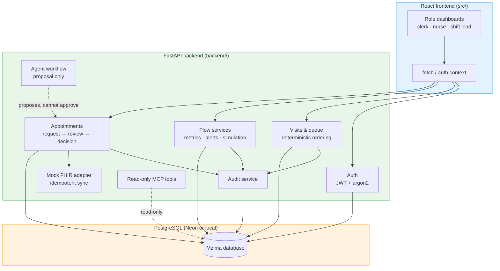
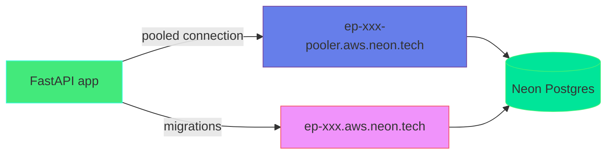

# Mzima | MCP-Enabled Healthcare Workflow & Capacity-Aware Queue Management

<div align="center">


**A synthetic-data prototype for outpatient queues, appointment coordination, and clinic scheduling**

*Connecting Healthcare Systems. Strengthening Human-Centred Care.*

</div>

> **Safety boundary:** Mzima is **not** approved for live care. It is not a diagnostic system and does not autonomously triage patients or change bookings or queue positions. Use **synthetic data only**.
>
> No AI model independently diagnoses patients, determines clinical urgency, or overrides professional clinical judgement. A named, authenticated clinician must approve any priority, referral, booking, or queue-affecting change.

The repository includes a synthetic appointment workflow: a deterministic slot tool proposes the earliest matching available slot, and only an authenticated clinician approval reserves it. No-match and stale-capacity cases fail closed. A local stdio FastMCP server exposes read-only operational summaries and bounded appointment tools; an optional loopback-only model may make proposals but cannot approve or book. See [EVALS.md](docs/EVALS.md) for evaluation status.

## What is Mzima?

Mzima is a proposed healthcare workflow and interoperability platform designed for **Level 6 public hospitals in Kenya**. It leverages the **Model Context Protocol (MCP)** to provide a controlled, standardized interface through which hospital applications, operational services, and intelligent systems can interact with facility resources.

At its core, Mzima connects **outpatient queue management**, **appointment coordination**, and **clinic scheduling** workflows while maintaining clear boundaries between automated operations and human clinical authority. Rather than replacing healthcare professionals, Mzima aims to reduce administrative friction, improve access to operational information, and provide accountable workflows that support healthcare workers.

Follow [backend/BACKEND_README.md](backend/BACKEND_README.md) for Python setup, database migrations, the API, and synthetic test helpers. The frontend is in [frontend/](frontend/) and its setup is documented in [FRONTEND_README.md](FRONTEND_README.md); Vite proxies API requests to `http://127.0.0.1:8000` by default.

This repository is a **synthetic-data prototype** with a FastAPI backend, React frontend, a local stdio MCP server, and an explicit clinician approval gate. Operational MCP tools are read-only; appointment tools can look up slots and create proposals, while only an authorized clinician can approve or reject. Use synthetic data only; it is not ready for live care or deployment. Run `uv run pytest -v` for workflow tests and `npm --prefix frontend run build` for the frontend production check. Model behavior still requires separate evaluation; see [docs/EVALS.md](docs/EVALS.md).


## The Problem We Are Solving

Outpatient departments must coordinate high patient volumes, limited resources, available service points, and changing workloads. These activities become difficult to manage when information and operational processes are fragmented or heavily dependent on manual coordination.

Key challenges:

- Limited visibility into patient queues, waiting times, and facility capacity.
- Fragmented communication between hospital applications and operational services.
- Administrative delays in coordinating appointment requests and available slots.
- Limited traceability of queue adjustments, staff interventions, and booking decisions.
- Difficulty integrating emerging digital tools without compromising security, accountability, and existing workflows.

Mzima addresses these challenges through a connected operational platform with controlled access to healthcare workflow capabilities.

---

## The Opportunity

| Gap | Opportunity |
|-----|-------------|
| **System interoperability** | Standardized interfaces that let hospital applications and services exchange information and invoke controlled operational capabilities. |
| **Fragmented workflows** | Connect patient registration, queue management, appointment coordination, and clinic scheduling within one coherent operational environment. |
| **Capacity-aware operations** | Improve visibility into waiting times, available service points, and operational workload. |
| **Clinical accountability** | Keep clinical priorities subject to approved protocols, professional validation, authorized changes, and audit trails. |
| **Local adaptability** | Build interoperable solutions suited to Kenyan healthcare workflows, infrastructure constraints, and data-protection requirements. |

---

## Our Proposed Solution

Mzima is built around an **MCP-enabled backend** that exposes controlled healthcare workflow capabilities to authorized applications and services.

### 1. MCP-Based Interoperability Layer

The Mzima MCP server acts as a controlled interface between applications, operational services, and connected healthcare systems. It exposes narrowly defined tools for:

- retrieving appointment slots,
- accessing queue information,
- generating booking proposals,
- executing authorized workflow actions.

This lets systems communicate through a standardized interface while enforcing authentication, permissions, validation, and audit requirements.

**In this prototype:** the read-only MCP tool layer exposes `get_live_queue_summary` and `get_pending_appointment_reviews`. Slot retrieval and commit tools remain on the roadmap.

### 2. Capacity-Aware Queue Management

Mzima manages walk-in registration, queue tokens, waiting-time tracking, and facility-approved prioritisation rules.

Clinical safety is maintained through four principles:

1. **Deterministic rules** implement facility-approved clinical protocols.
2. **Clinical warning signs** are surfaced alongside their supporting observations.
3. **Nurses validate** clinical priorities.
4. **Queue changes are authorized and audited.**

Implemented ordering rules:

1. Red-flag fast-track visits first.
2. Visits at or above the 120-minute wait cap next.
3. Remaining visits by calculated score, descending — `minutes_waiting × age_weight` (`1.5` for `under_5` and `over_65`, otherwise `1.0`).
4. Arrival time and token number break ties deterministically.

### 3. Controlled Appointment Coordination

The platform supports appointment requests, slot availability checks, and booking proposals. Where automated systems generate proposals, a **named and authenticated clinician must explicitly approve the decision** before a booking can be committed through the clinic integration layer.

**In this prototype:** an agent can create a `PROPOSED_BY_AGENT` appointment request and audit that proposal. It cannot approve it. Approval requires a `SHIFT_LEAD` (or `ADMIN`) decision, which is recorded with the clinician's identity and reason. Approved requests can then be synchronized through a **mock FHIR facility adapter** with an idempotency key.

---

## Why Mzima

- **MCP-based interoperability** for controlled access to healthcare workflow services.
- **Connected outpatient workflows** spanning queues, appointments, and scheduling.
- **Deterministic implementation** of facility-approved clinical protocols.
- **Human-authorized** clinical prioritisation and appointment decisions.
- **Auditable operations** and secure integration boundaries.
- **Architecture designed for local deployment** and future healthcare-system integration.

---

## Our Vision

Our vision is to establish a connected and interoperable foundation for outpatient healthcare operations in Kenya. Mzima aims to make healthcare workflows more transparent, improve coordination between hospital systems, and empower healthcare professionals with reliable operational tools.

By placing interoperability, accountability, and human clinical authority at the centre of its design, Mzima seeks to contribute to a more connected and efficient healthcare ecosystem.

---

## Implementation Status

| Capability | Status |
|------------|--------|
| Walk-in registration, queue tokens, weighted queue | Implemented |
| Triage workflow | Implemented |
| Clinical warning-sign alerts with supporting observations | Implemented |
| Deterministic flow metrics, bottlenecks, recommendations, simulation | Implemented |
| Appointment request → clinician review → decision → audit | Implemented |
| Read-only MCP tools (queue summary, pending reviews) | Implemented |
| Mock FHIR synchronization for approved bookings | Implemented |
| Agent booking proposal with human-approval guardrail | Implemented as scaffolding |
| MCP appointment-slot retrieval and routing tools | Planned |
| Agent commit tool with one-time approval token | Planned |
| Local/in-country model deployment | Planned |
| Live HMIS/FHIR integration | Not implemented — mock adapter only |

---

## Project Layout

The repository root is the single project root. The Python backend lives in `backend/`, the React frontend in `src/`, with migrations, data scripts, docs, and configuration at the root.

```mermaid
graph TD
    ROOT["mzima/ (root)"]

    ROOT --> BACKEND["backend/ (FastAPI)"]
    ROOT --> SRC["src/ (React + Vite)"]
    ROOT --> MIG["migrations/ (Alembic)"]
    ROOT --> SCR["scripts/ (seed + verification)"]
    ROOT --> DOCS["docs/ (design & governance)"]
    ROOT --> ENV[".env"]
    ROOT --> CONFIG["alembic.ini · package.json · vite.config.ts"]

    BACKEND --> ADAPT["adapters/clinic/ (mock FHIR)"]
    BACKEND --> AGENT["agent/ (proposal workflow)"]
    BACKEND --> API["api/v1/ (auth, visits, queue, appointments, flow, audit)"]
    BACKEND --> CORE["core/ (settings)"]
    BACKEND --> DB["db/ (SQLAlchemy session)"]
    BACKEND --> MCP["mcp/ (read-only tools)"]
    BACKEND --> MODELS["models/ (ORM)"]
    BACKEND --> SCHEMAS["schemas/ (Pydantic)"]
    BACKEND --> SERVICES["services/ (queue, flow, audit, appointments)"]
    BACKEND --> MAIN["main.py (entrypoint)"]

    SRC --> PAGES["pages/ (clerk, nurse, shift lead)"]
    SRC --> SECTIONS["sections/ (landing content)"]
    SRC --> COMPONENTS["components/"]
    SRC --> AUTHSRC["auth/"]
    SRC --> APISRC["api.ts"]
```



| Path | Purpose |
|------|---------|
| `backend/` | FastAPI application: API routes, domain models, queue/flow services, agent workflow, read-only MCP tools |
| `src/` | React + TypeScript + Vite frontend with role-specific dashboards |
| `migrations/` | Alembic schema migrations |
| `scripts/` | Seeding (`seed_data.py`, `seed_flow.py`), Synthea import, phase checks |
| `docs/` | Architecture, privacy, evaluation, deployment, and frontend documentation |
| `backend/pyproject.toml` | Backend package and dependencies (managed with `uv`) |
| `.env` | Environment variables (PostgreSQL/Neon, secret key, optional model gateway) |
| `neon.ts`, `render.yaml`, `vercel.json` | Neon, Render, and Vercel configuration |

---

## Start Locally


### Prerequisites

| Tool | Version | Purpose |
|------|---------|---------|
| Python | 3.11+ | Backend runtime |
| [`uv`](https://docs.astral.sh/uv/) | Latest | Python environment and dependency management |
| Node.js | 20+ | Frontend dev/build |
| PostgreSQL | 14+ | Database (local or Neon) |

### 1. Configure the database

**Option -> Neon Cloud (recommended for demos):**

Create a project at [neon.tech](https://neon.tech) and copy the pooled connection string into `DATABASE_URL`. See [Neon Database Integration](#neon-database-integration).

### 2. Configure the environment

From the repository root:

```bash
cp .env.example .env
# Edit .env: set DATABASE_URL, DATABASE_URL_UNPOOLED, SECRET_KEY,
# and optionally AGENTROUTER_API_KEY / BASE_URL / MODEL_NAME.
```

Never commit `.env` or real credentials.

### 3. Install backend dependencies

```bash
uv sync --project backend
```

This creates or updates `backend/.venv` from `backend/pyproject.toml` and `backend/uv.lock`.

### 4. Initialize the database

```bash
uv run --project backend alembic -c backend/alembic.ini upgrade head
```

Seed synthetic demo data (optional, but useful for the dashboards):

```bash
uv run --project backend python scripts/seed_data.py
uv run --project backend python scripts/seed_flow.py
uv run --project backend python scripts/import_synthea.py
```

### 5. Start the backend

From the repository root:

```bash
uv run --project backend uvicorn backend.main:app --reload --host 127.0.0.1 --port 8000
```

| Endpoint | Check |
|----------|-------|
| API | `http://127.0.0.1:8000` |
| Swagger | `http://127.0.0.1:8000/docs` |
| Health | `GET /health` |
| Readiness | `GET /ready` (tests DB connectivity) |

### 6. Start the frontend

In a separate terminal:

```bash
npm install
npm run dev
```

Open `http://localhost:5173`. Vite proxies `/api`, `/health`, and `/ready` to `http://127.0.0.1:8000` by default; set `MZIMA_API_URL` to point elsewhere.

### Quick checks

```bash
npm run build   # Type-check and build the frontend
```

Backend verification scripts require a reachable database:

```bash
uv run --project backend python scripts/test_phase5.py
uv run --project backend python scripts/test_phase6.py
```

---

## Architecture



### Trust boundaries

```mermaid
flowchart LR
    PATIENT["Patient / staff client"] --> API["Authenticated Mzima REST API"]
    API --> AGENT["Agent proposal"]
    AGENT --> REVIEW["Named clinician review"]
    REVIEW -->|"approve + reason"| DECISION["Audit logged decision"]
    DECISION --> ADAPTER["Clinic integration adapter"]
    ADAPTER --> HMIS["HMIS / FHIR<br/>(mock in prototype)"]
    AGENT -.->|"cannot approve"| REVIEW

    style REVIEW fill:#ffeaa7,stroke:#fdcb6e,color:#333
    style DECISION fill:#43e97b,stroke:#38f9d7,color:#333
```



The agent may plan, read, and propose. It **cannot** approve itself, commit a booking, or change queue priority. Any action outside the read-only or proposal boundary requires an authenticated human decision and produces an audit event.

### Core services

| Service | Description |
|---------|-------------|
| **Auth** | Login with argon2 password hashing, JWT (HS256), role-based access |
| **Visits & queue** | Walk-in registration, per-day tokens, triage updates, weighted queue ordering |
| **Flow** | Wait metrics, staffing/capacity snapshots, bottleneck scans, recommendations, simulations, clinical warning-sign alerts |
| **Appointments** | Appointment request → clinician review → decision → optional mock FHIR synchronization |
| **Agent** | Booking proposals marked `PROPOSED_BY_AGENT` with a human-approval invariant |
| **Audit** | Event logging for security and compliance |
| **MCP** | Read-only tools exposing queue summary and pending appointment reviews |

---

## Authentication & Roles

| Role | Permissions |
|------|-------------|
| `CLERK` | Register walk-in visits, login/logout |
| `NURSE` | Register visits, complete triage, call patients, queue operations |
| `SHIFT_LEAD` | All queue operations + appointment review, approve/reject, sync approved bookings, audit access |
| `ADMIN` | Administrative access across the above |

**Default seeded accounts** (synthetic testing only):

| Username | Password | Role |
|----------|----------|------|
| `clerk1` | `clerkpass123` | `CLERK` |
| `nurse1` | `nursepass123` | `NURSE` |
| `lead1` | `leadpass123` | `SHIFT_LEAD` |

---

## API Reference

All application routes are under `/api/v1`; health checks are at the root.

### System

| Method | Path | Description |
|--------|------|-------------|
| `GET` | `/health` | Liveness check |
| `GET` | `/ready` | Database connectivity check |
| `GET` | `/v1/models` | Compatibility model listing for agent clients |

### Authentication

| Method | Path | Description |
|--------|------|-------------|
| `POST` | `/api/v1/auth/login` | Login and receive a JWT |
| `GET` | `/api/v1/auth/me` | Current user info |

### Visits & queue

| Method | Path | Description |
|--------|------|-------------|
| `POST` | `/api/v1/visits` | Register a walk-in visit (clerk) |
| `GET` | `/api/v1/queue` | Live weighted queue |
| `POST` | `/api/v1/queue/{visit_id}/call` | Call a patient, with optional override reason |
| `POST` | `/api/v1/visits/{visit_id}/triage` | Complete triage (nurse) |

### Appointments

| Method | Path | Description |
|--------|------|-------------|
| `POST` | `/api/v1/appointments/appointment-requests` | Create a pending appointment request |
| `GET` | `/api/v1/appointments/clinic/review-queue` | Pending clinician reviews |
| `POST` | `/api/v1/appointments/appointment-requests/{request_id}/decision` | Approve or reject with a reason |
| `GET` | `/api/v1/appointments/appointments/{request_id}` | Appointment request details |
| `POST` | `/api/v1/appointments/appointment-requests/{request_id}/sync` | Sync an approved request through the mock FHIR adapter (idempotency key required) |

### Flow intelligence

Selected routes under `/api/v1/flow`:

| Method | Path | Description |
|--------|------|-------------|
| `GET` | `/summary` | Queue and capacity summary |
| `GET` | `/wait-metrics` | Waiting-time metrics |
| `GET` | `/pilot-validation` | Pilot snapshot / validation view |
| `GET` | `/stations` | List assessment stations |
| `POST` | `/stations` | Create an assessment station |
| `PATCH` | `/stations/{station_id}` | Update an assessment station |
| `GET` | `/staffing` | Staffing capacity |
| `POST` | `/staffing` | Add a staffing entry |
| `POST` | `/capacity/snapshot` | Capacity snapshot |
| `POST` | `/bottleneck-scan` | Detect bottlenecks |
| `GET` | `/bottlenecks` | List bottleneck alerts |
| `POST` | `/bottlenecks/{alert_id}/review` | Review a bottleneck alert |
| `POST` | `/recommendations/scan` | Generate operational recommendations |
| `GET` | `/recommendations` | List recommendations |
| `POST` | `/recommendations/{recommendation_id}/review` | Review a recommendation |
| `GET` | `/clinical-alerts` | Evidence-backed warning-sign alerts |
| `POST` | `/clinical-alerts/{alert_id}/review` | Review a clinical alert |
| `GET` | `/observations` | List synthetic observation sets |
| `POST` | `/observations` | Create an observation set |
| `POST` | `/observations/extract` | Optional AgentRouter free-text extraction (`requires_human_review: true`) |
| `GET` | `/triage-sources` | Triage source metadata |
| `GET` | `/public-health-context` | Synthetic public-health context |
| `POST` | `/simulations` | Run an operational simulation |
| `GET` | `/simulations/{scenario_id}` | Retrieve a simulation |
| `GET` | `/metric-snapshots` | List metric snapshots |
| `POST` | `/metric-snapshots` | Record a metric snapshot |

### Audit

| Method | Path | Description |
|--------|------|-------------|
| `GET` | `/api/v1/audit/events` | Recent audit events, filterable by entity type/id (shift lead/admin) |

---

## Testing & Verification

```bash
# Mock FHIR export + read-only MCP tools (requires DB)
uv run --project backend python scripts/test_phase5.py

# Agent proposal and human-approval safety invariant (requires DB)
uv run --project backend python scripts/test_phase6.py

# Frontend type-check and production build
npm run build
```

### Safety invariants under test

- **Phase 5**: Mock FHIR export, read-only MCP tools (queue digest, pending reviews).
- **Phase 6**: Agent proposes a booking → invariant check confirms the request is **not** approved → explicit clinician decision is logged against a named user.
- **Core invariant**: the agent cannot autonomously approve appointment requests; human clinician sign-off is mandatory.
- **Queue invariant**: ordering is deterministic and explainable — fast-track, wait cap, weighted score, then stable tie-breakers.

See [docs/EVALS.md](docs/EVALS.md) for the evaluation plan. It records test design, not measured results.

---

## Safety & Compliance

| Concern | Handling |
|---------|----------|
| Patient data | Synthetic only; never use real patient information |
| Autonomous triage | **Prohibited** — no auto-triage, auto-prioritisation, or auto-approval |
| Clinical warning signs | Surfaced with supporting observations for nurse validation |
| Queue changes | Authorized, deterministic, and audit logged |
| Appointment decisions | Named clinician approval with reason, captured in the audit trail |
| PII | No real PII in code, commits, issues, or demos |
| Integration | Mock FHIR adapter only; no live HMIS integration |
| Privacy docs | [docs/DATA_AND_PRIVACY.md](docs/DATA_AND_PRIVACY.md) |

---

## Neon Database Integration



### Configuration

Set the connection strings in `.env`:

- `DATABASE_URL` → pooled connection for application traffic.
- `DATABASE_URL_UNPOOLED` → direct connection for tooling and migrations when the pooler does not support DDL.

Alembic reads `DATABASE_URL` through `backend/core/config.py`. Point it at the direct URL when running migrations if your pooler rejects DDL or advisory locks, then switch it back for normal application traffic.

Use a separate Neon branch per developer or per feature to keep schema changes isolated.

### Branching workflow

```bash
# Create a branch from the Neon console or CLI, then point the environment at it
uv run --project backend alembic -c backend/alembic.ini upgrade head
# Delete the branch when the work is merged
```

`neon.ts` configures Neon branch compute sizing, TTL, and suspend-on-idle behaviour. It contains no connection strings or credentials.

---

## Data & Privacy

- **Synthetic data only** — no real patient identifiers or PHI.
- **No persistent file storage** — application data lives in PostgreSQL.
- **Audit logged** — check-in, patient calls, triage completion, appointment decisions, and approved-booking synchronization create audit events.
- **Audit access** — restricted to `SHIFT_LEAD` and `ADMIN`.
- **Passwords** — argon2 hashing; JWT-based sessions.
- **Retention and controller** — not yet finalized; the pilot facility and hosting environment have not been selected.

See [docs/DATA_AND_PRIVACY.md](docs/DATA_AND_PRIVACY.md) for the data policy and retention design.

---

## Roadmap

| Feature | Status | Notes |
|---------|--------|-------|
| MCP appointment-slot retrieval | Planned | Read-only tools for available slots |
| MCP transport for `ReadOnlyMzimaMCP` | Planned | Currently an in-process Python tool layer; no MCP protocol server yet |
| MCP routing proposal tool | Planned | Deterministic eligibility checks plus grounded rationale |
| Clinician commit with one-time approval token | Planned | Idempotent, audited write path |
| Agent proposal/commit hardening | In progress | Proposal + guardrail scaffolding exists in `backend/agent/` |
| Unify agent proposal status with the clinician review queue | Planned | Review queue currently filters `PENDING_REVIEW`; agent proposals use `PROPOSED_BY_AGENT` |
| Local/in-country model deployment | Planned | Data-sovereignty requirement for any pilot |
| Live HMIS/FHIR integration | Not started | Mock adapter boundary is in place |
| Concurrent-safe token generation | Planned | Replace count-based generation with a sequence or lock |

---

## Documentation

| Doc | Purpose |
|-----|---------|
| [docs/MZIMA_SYSTEM_DESIGN.md](docs/MZIMA_SYSTEM_DESIGN.md) | Product requirements and acceptance criteria |
| [docs/ARCHITECTURE.md](docs/ARCHITECTURE.md) | Component boundaries, trust boundaries, and data model |
| [docs/BACKEND_TECHNICAL_GUIDE.md](docs/BACKEND_TECHNICAL_GUIDE.md) | Backend setup and endpoint details |
| [docs/FRONTEND_DESIGN.md](docs/FRONTEND_DESIGN.md) | Frontend design and scope |
| [docs/FRONTEND_INTEGRATION_GUIDE.md](docs/FRONTEND_INTEGRATION_GUIDE.md) | Frontend ↔ backend integration |
| [docs/DATA_AND_PRIVACY.md](docs/DATA_AND_PRIVACY.md) | Synthetic data policy and retention |
| [docs/EVALS.md](docs/EVALS.md) | Evaluation plan (not measured results) |
| [docs/CLOUD_DEPLOYMENT_AND_DATAFLOW.md](docs/CLOUD_DEPLOYMENT_AND_DATAFLOW.md) | Proposed deployment and data-flow path |
| [docs/TECH_STACK.md](docs/TECH_STACK.md) | Stack choices and constraints |
| [docs/TEAM_ROLES.md](docs/TEAM_ROLES.md) | Team responsibilities |
| [docs/IMPLEMENTATION_CHANGELOG.md](docs/IMPLEMENTATION_CHANGELOG.md) | Implemented queue, flow, audit, and integration work |

---

## Licence

See [LICENSE](LICENSE). All code and documentation are provided as-is without warranty.

---

<div align="center">

**Mzima — Connecting Healthcare Systems. Strengthening Human-Centred Care.**

</div>
