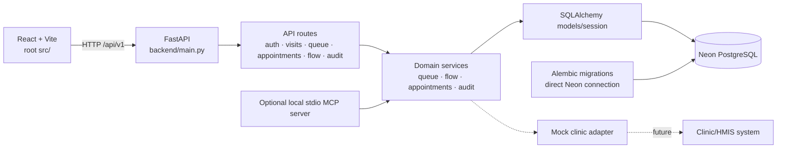
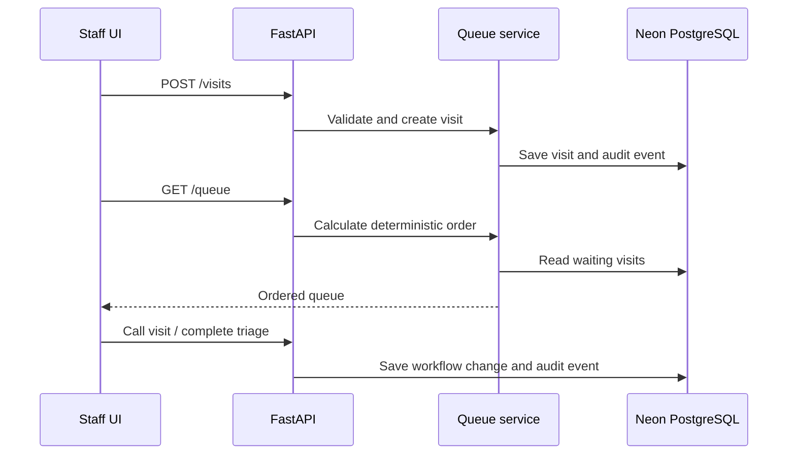
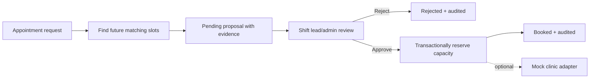

# Mzima architecture

## Scope

Mzima is a synthetic-data prototype for outpatient queue management and appointment requests. The implemented system has one web client, one FastAPI service, and one Neon PostgreSQL database.



The browser never connects directly to Neon. The database is accessed only by the backend. `DATABASE_URL` is the pooled Neon connection for API traffic; `DATABASE_URL_UNPOOLED` is the direct connection used by Alembic.

## Repository structure

```text
src/                         Active React/Vite frontend
backend/
  main.py                    FastAPI application entry point
  api/v1/endpoints/          HTTP route handlers
  services/                  Queue, flow, appointment, and audit logic
  models/                    SQLAlchemy ORM models
  schemas/                   Pydantic request/response models
  db/session.py              PostgreSQL engine and session factory
  core/config.py             Environment settings
  mcp/server.py              Optional local stdio tools
  adapters/clinic/           Mock clinic integration
backend/migrations/          Alembic revisions
tests/                       API and workflow tests
scripts/                     Synthetic data and verification scripts
docs/                        Architecture, privacy, deployment, and product docs
```

The root `package.json`, `vite.config.ts`, and `src/` are the active frontend project.

## Main workflows

### Walk-in queue



Queue ordering is deterministic: fast-track visits first, then long waits, then the age-weighted wait score. It is an operational rule, not an automated clinical diagnosis.

### Appointment request and approval



The proposal is not a booking. Only an authenticated shift lead or admin can approve or reject it. The optional local model can assist with bounded proposal work, but it cannot approve, reject, reserve capacity, or call an external clinic system.

### Flow operations

Flow endpoints read observations and operational data, then calculate metrics, bottlenecks, alerts, recommendations, and simulations. Model-assisted extraction, when enabled, returns a human-review-required result; it does not assign a diagnosis or clinical priority.

## Boundaries and non-goals

- Authentication and role checks are enforced by FastAPI; the frontend is not a security boundary.
- Audit events are written by backend workflows alongside sensitive changes.
- The MCP server is a local stdio process, not an authenticated public API.
- The clinic/FHIR adapter is a mock prototype. No live HMIS or FHIR integration is implemented.
- LangGraph orchestration, Next.js, Prisma, and a separate production MCP database server are not part of the current implementation.
- Use synthetic data only. This prototype is not approved for live clinical care.
