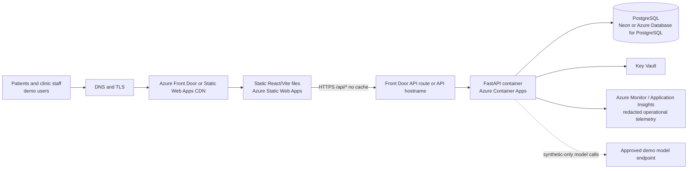
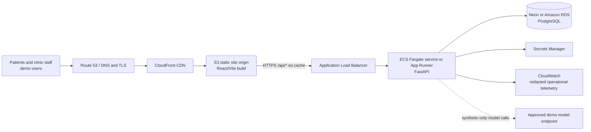
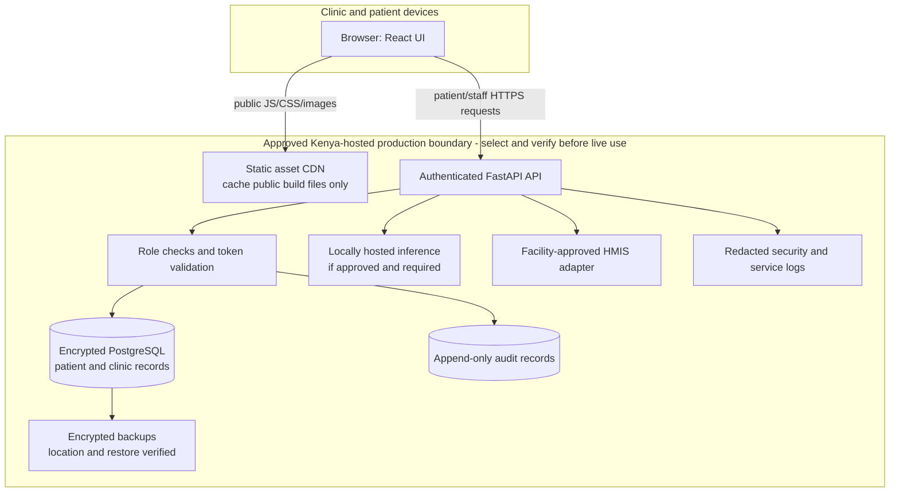
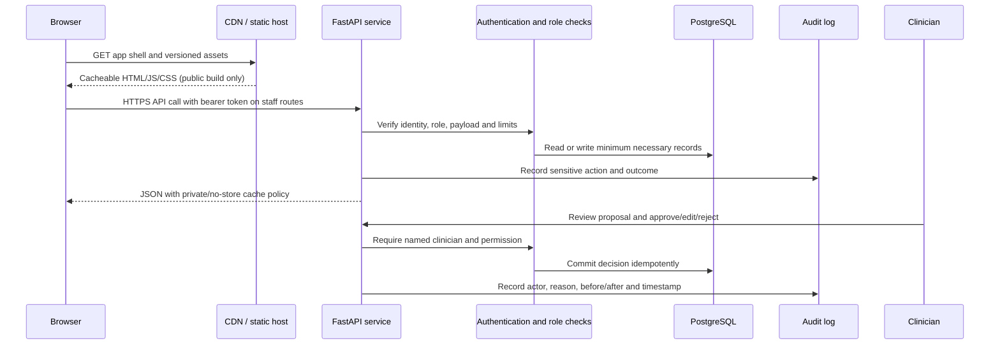

# Mzima Cloud Deployment, Traffic and Data Flow

**Status:** proposed deployment guide. The repository is a prototype; this document describes a path from synthetic-data demos to a governed pilot. It does not claim that the cloud deployment, high availability, or production controls described here are already implemented.

## Executive recommendation

Use Azure or AWS credits to host a **synthetic-data demo** and learn the operational shape of Mzima. CloudPlexo advertises AWS credits and technical support; these are AWS credits, not Azure credits. Azure credits are separate and depend on the Microsoft for Startups offer for which the startup qualifies. [CloudPlexo for Startups](https://cloudplexo.com/startups/) · [Microsoft for Startups](https://learn.microsoft.com/en-us/startups/microsoft-for-startups/getting-started-mfs)

Keep the stack small at first: static frontend behind a CDN, one managed FastAPI service, managed PostgreSQL, centralized secrets and logs, and budget alerts. Existing code uses Vite/React, FastAPI, SQLAlchemy/Alembic, and PostgreSQL. The current deployment files target Vercel for the frontend and Render for the backend; Neon is the documented cloud database option.

The privacy docs require the full patient workflow, model inference, database, logs, backups, and support access to remain in Kenya. Azure's currently listed African public regions are in South Africa; do not treat an Azure/AWS region outside Kenya as satisfying this project requirement. Use cloud credits with synthetic data unless the data controller approves a different residency design and verifies all service data paths. [Azure regions list](https://learn.microsoft.com/en-us/azure/reliability/regions-list) · [Project data and privacy requirements](DATA_AND_PRIVACY.md)

## Deployment views

### Option A: Azure credit-backed demo

Use Static Web Apps for the built Vite site and Container Apps or App Service for the Python API. Azure Database for PostgreSQL is an option if you intentionally migrate from Neon; it is not necessary to move the database just because the API moves to Azure. Credit eligibility varies by sponsored subscription and service; verify each service in Cost Management before relying on credits. [Azure startup credit use](https://learn.microsoft.com/en-us/startups/build/getting-started/use-startup-credits)

### Option B: CloudPlexo / AWS credit-backed demo

CloudPlexo's published offer is AWS-focused. Ask CloudPlexo to confirm current credit amount, eligibility, activation steps, expiration, eligible AWS services, and whether its technical support or proof of concept is included for this startup. Do not assume the headline credit amount or every Marketplace purchase is available to this project. [CloudPlexo for Startups](https://cloudplexo.com/startups/)

### Production boundary and data flow

The production host is intentionally shown as an **unselected Kenya-hosted environment**, not Azure or AWS. Before live records are used, verify the location of database replicas, backups, logs, telemetry, model processing, support access, and any HMIS connection with the facility and data controller. If the full path cannot meet the approved residency and governance requirements, keep the deployment synthetic-data-only.

## Request and traffic handling

### CDN and caching

- Cache only the public frontend build: hashed JS/CSS, icons, and non-sensitive images. Use long-lived immutable caching for content-hashed assets; use short/no-cache revalidation for the HTML entry point so deployments take effect.
- Route `/api/*` to the API origin over HTTPS. Disable shared CDN caching for authenticated and patient-specific API responses (`Cache-Control: private, no-store`). Never cache authorization headers, queue responses, appointment records, or patient identifiers at the edge.
- Do not put patient data in URLs, query strings, frontend analytics, CDN logs, error-reporting payloads, or cache keys. Keep request bodies and authorization headers out of access logs.
- Apply TLS, security headers, request size limits, and rate limits at the edge/API. Rate limits should protect login and expensive endpoints while allowing normal clinic bursts; tune them using pilot observations rather than a made-up fixed threshold.

## API boundary

The frontend already calls the FastAPI `/api/v1` endpoints through `src/api.ts`. The router currently exposes authentication, queue, appointments, and flow routes. Publish only the required API hostname/origin; the database must not be browser-accessible.

| API area | Existing route examples | Access and handling |
|---|---|---|
| Health | `GET /health`, `GET /ready` | Liveness/readiness for platform probes. Avoid returning internal errors or secrets. Readiness checks database connectivity. |
| Authentication | `POST /api/v1/auth/login`, `GET /api/v1/auth/me` | TLS only; rate-limit login; use strong secrets, short-lived tokens appropriate to clinic operations, role checks, and secure credential storage. |
| Walk-in visits and queue | `POST /api/v1/visits`, `GET /api/v1/queue`, `POST /api/v1/queue/{id}/call` | Require staff identity and least-privilege role; validate payloads; record queue-affecting changes in audit trail. |
| Appointment workflow | `POST /api/v1/appointments/appointment-requests`, `GET /api/v1/appointments/clinic/review-queue`, `POST /api/v1/appointments/appointment-requests/{id}/decision` | Keep proposals pending until an authorized named clinician makes a decision. Use idempotency for commit/booking integration. |
| Flow optimization | `POST /api/v1/flow/observations/extract` and related flow routes | Apply input limits and timeout; do not send real patient text to external model APIs unless the approved data path explicitly permits it. |

Use OpenAPI generated by FastAPI as the API contract, but expose interactive docs only in development/staging or behind staff authentication in production. Add versioning and backward-compatible migrations before integrating a facility HMIS. Never assume the facility supports FHIR; implement only against its documented interface.

## Patient data storage and lifecycle

### What to store

Store the minimum fields the facility has approved for the workflow. The current project policy proposes random request IDs, service requested, preferred times, structured visit reason, language, status/timestamps, proposal evidence, clinician decisions, appointments, operational capacity, and audit events. Contact details are optional and need a defined confirmation purpose. Avoid national ID, full date of birth, diagnosis, biometrics/voiceprints, and raw audio by default. Free text and contact data linked to a person are sensitive health-related data.

### Where and how

- Store transactional records in PostgreSQL, encrypted in transit and at rest, with private network access where supported. Give the application a restricted database role; keep migrations on a separate controlled credential.
- Keep audit events append-only for ordinary application users. Capture actor, timestamp, route/tool, minimized inputs, status, retries, and before/after values for queue-affecting changes. Avoid duplicating whole patient payloads in audit details.
- Store secrets (database credentials, JWT signing keys, HMIS credentials) in the hosting provider's secret manager, not in Git, frontend variables, or container images. Rotate credentials and separate demo/staging/production secrets.
- Do not store patient files or audio in object storage unless a defined need and retention policy exist. If needed, use private buckets, encryption, narrow signed access, malware checks where relevant, and lifecycle deletion rules.
- Set facility-approved retention for unconfirmed requests, confirmed appointments, audit events, backups, and derived data. Implement correction and secure deletion processes. Restrict and test backup restore; a backup's region is part of data residency.
- Use synthetic or irreversibly de-identified data in demos, cloud experiments, screenshots, logs, support tickets, and external model evaluations.

### Failure behavior

If the database is unavailable, readiness should fail, writes should return a clear retry/staff-handoff response, and requests must not disappear silently. Keep integrations idempotent; after a timeout, check whether the booking succeeded before retrying. If model or extraction calls fail or are uncertain, keep the item pending for staff review. The model never approves its own proposal.

## Capacity and scaling plan

No trustworthy production traffic target or benchmark is present in the repository, so do not size instances or promise requests-per-second yet. Use the following measurement-led progression:

| Stage | Shape | Capacity behavior |
|---|---|---|
| Local development | One API process, local/test database | Synthetic data; no availability commitment. |
| Demo | One small API instance/container, managed Postgres, CDN for static assets | Set a low maximum spend; allow manual restart; collect response latency, error rate, DB connections, CPU/memory, and request volume. |
| Pilot readiness | API with at least two replicas across available fault domains if the chosen host supports it; health probes; managed DB backups; restore rehearsal; alerts | Load-test representative clinic bursts and queue reads; define acceptable latency, recovery time, and recovery point with the facility. Verify connection limits and pool sizes. |
| Production | Capacity based on observed pilot peaks and agreed SLOs; autoscaling bounds; database sizing/HA/backup plan; operational on-call | Scale API replicas horizontally for stateless request handling; scale database vertically/through supported read scaling only after query and connection measurement. Keep database writes authoritative and transactional. |

Traffic paths: the CDN absorbs repeat downloads of static assets; it does **not** accelerate or cache private clinic records. API replicas can scale horizontally only if sessions are stateless or stored in shared managed infrastructure. Set explicit min/max replicas to avoid sudden cost growth. Bound database pool size per replica so `replicas × pool size` stays within database connection limits. Add a queue/background worker only when work becomes asynchronous or slow (for example, a facility-approved integration); use retries with backoff and idempotency keys.

Monitor aggregate metrics: request counts and latency by route/status, saturation (CPU/memory), DB pool wait and connection count, slow queries, queue depth, integration failures, and auth abuse. Logs should use correlation IDs and omit names, contact details, symptoms, request bodies, and tokens. Define alert thresholds from pilot baselines and service expectations.

## Credit usage and cost controls

| Cost area | Azure credit experiment | CloudPlexo AWS credit experiment |
|---|---|---|
| Static hosting/CDN | Static Web Apps / Front Door (check offer eligibility and pricing) | S3 + CloudFront |
| API compute | Container Apps or App Service | App Runner or ECS Fargate |
| Database | Keep Neon, or evaluate Azure Database for PostgreSQL | Keep Neon, or evaluate RDS for PostgreSQL |
| Secrets and telemetry | Key Vault + Azure Monitor | Secrets Manager + CloudWatch |
| Cost guardrails | Budget, usage alerts, tags, resource cleanup | Budgets, billing alerts, tags, resource cleanup |

Set budgets and alerts before creating resources. Tag resources by environment and owner, restrict expensive SKUs/regions, cap autoscaling, avoid always-on GPU/model compute until needed, and delete temporary demo resources. Credits have eligibility, expiry, and service restrictions; check the program portal and billing account rather than assuming the whole architecture is covered. Neon and other non-Azure/non-AWS services may continue to bill separately.

## Operational checklist before a pilot

- [ ] Facility/data controller approves purpose, fields, roles, retention, and hosting location.
- [ ] Confirm every service's region for primary data, replicas, backups, logs, inference, telemetry, and support access.
- [ ] Synthetic-data-only environments are clearly separated from any future live-data environment.
- [ ] API authentication, role authorization, TLS, CORS allowlist, rate limits, secret management, and production debug settings are reviewed.
- [ ] Database network access, least-privilege accounts, migration process, backup encryption, and restore procedure are verified.
- [ ] CDN is configured to cache only static public assets; API responses are private and not cached.
- [ ] Audit behavior, clinician approval gate, idempotent commits, staff handoff, and outage procedures are demonstrated.
- [ ] Load test with representative synthetic traffic; record peak capacity and database connection usage.
- [ ] Budget alerts, service alerts, incident contacts, and resource cleanup are assigned.

## Related project documents

- [Data, Privacy and Safety](DATA_AND_PRIVACY.md)
- [Architecture](ARCHITECTURE.md)
- [Technical stack](TECH_STACK.md)
- [Backend setup](../BACKEND_SETUP.md)
