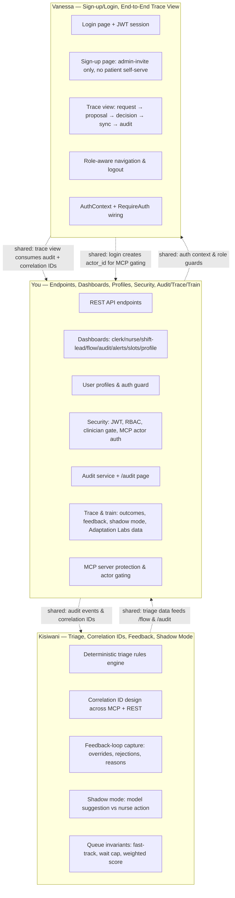
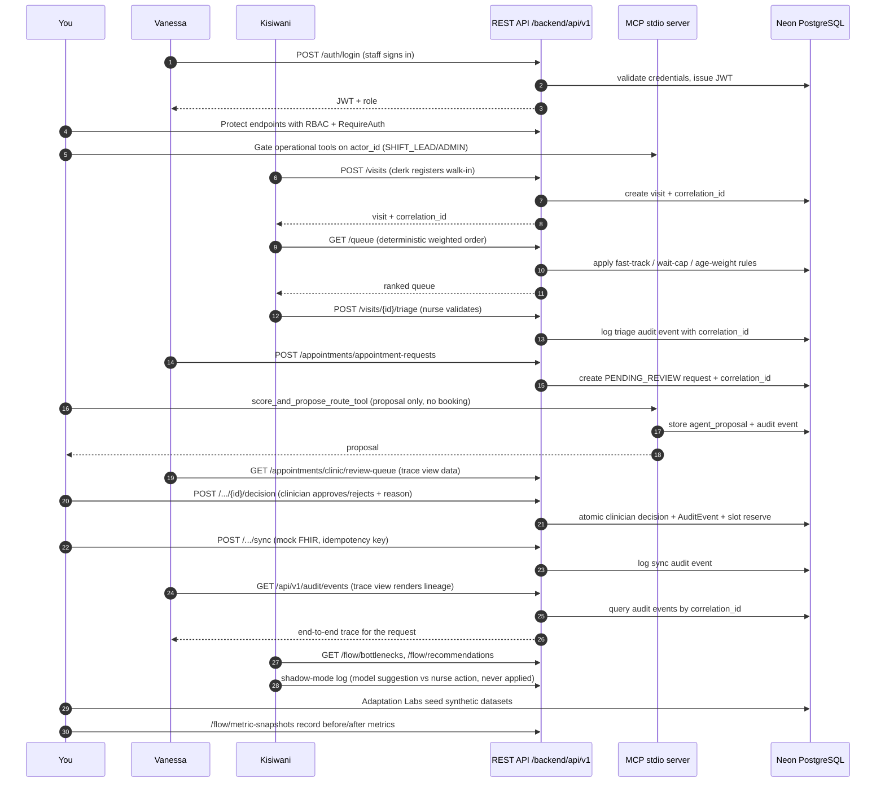

# Mzima — Team Roles & Collaboration

**Team:** 3 people  
**Scope:** Synthetic-data prototype for outpatient queue management, appointment coordination, and clinic scheduling.  
**Safety boundary:** Mzima is not approved for live care. No autonomous triage, auto-prioritisation, or auto-booking. A named, authenticated clinician must approve any priority, referral, booking, or queue-affecting change. Use synthetic data only.

---

## Team roster

| Member | GitHub handle | Primary focus |
|--------|--------------|---------------|
| **You** | — | Backend endpoints, dashboards, user profiles, security, audit/trace/train, MCP entry surface, `/flow`, `/audit`, clinical alerts, `/slots`, `/profile`, dataset improvement via Adaptation Labs |
| **Kisiwani** | — | How triage is solved, correlation IDs through MCP and REST calls, feedback loop, shadow mode |
| **Vanessa** | — | Sign-up / login page, end-to-end trace view (appointment request → proposal → clinician decision → sync → audit events) |

---

## 1. Your scope (endpoints, dashboards, profiles, security, audit/trace/train)

You own the **server-side API surface**, the **staff-facing dashboards**, **user profiles**, and the **security boundary** around everything.

### Backend endpoints (`backend/api/v1/`)
- Walk-in registration, queue list, call-with-override, triage completion (`/visits`, `/queue`, `/queue/{id}/call`, `/visits/{id}/triage`)
- Appointment requests, slot lookup, clinician review queue, approve/reject decision, sync through mock FHIR adapter (`/appointments/...`)
- Flow intelligence: summary, wait metrics, stations, staffing, capacity snapshot, bottleneck scan/review, recommendations/review, clinical alerts/review, observations/extract, simulations, metric snapshots (`/flow/...`)
- Audit events list (`/audit/events`, shift-lead/admin only)
- Auth: login, `/me`, role-based JWT (`/auth/login`, `/auth/me`)

### Dashboards and pages you build
| Page | Route | Owner | Audience |
|------|-------|-------|----------|
| Clerk dashboard | `/clerk/dashboard` | You | CLERK |
| Nurse dashboard | `/nurse/dashboard` | You | NURSE |
| Shift-lead dashboard | `/shift-lead/dashboard` | You | SHIFT_LEAD / ADMIN |
| Flow / operations | `/flow` | You | SHIFT_LEAD / ADMIN |
| Audit log | `/audit` | You | SHIFT_LEAD / ADMIN |
| Clinical alerts | `/clinical-alerts` | You | NURSE / SHIFT_LEAD / ADMIN |
| Appointment slots | `/slots` | You | All staff (read-only booking) |
| User profile | `/profile` | You | All staff |
| Visits / queue | `/visits` | You | CLERK / NURSE |
| Triage | `/triage` | Shared with Kisiwani | NURSE |
| Review | `/review` | Shared with Vanessa | SHIFT_LEAD / ADMIN |

### Security (your ownership)
- JWT issuance/validation with argon2 password hashing
- Role-based access control (CLERK / NURSE / SHIFT_LEAD / ADMIN) on every mutating endpoint
- `RequireAuth.tsx` guard wired to all staff routes; role checks enforced by the API, not just the UI
- Clinician approval gate: no endpoint lets the MCP server or any agent approve, reject, reserve capacity, or commit a booking
- Audit actor identity attached to every state-changing event
- MCP operational tools require an authenticated `actor_id` (SHIFT_LEAD/ADMIN); the standalone stdio process fails closed without one
- Synthetic-data-only enforcement: no real patient identifiers or PHI in code, commits, or demos

### Audit / trace / train (your ownership)
- **Audit:** `log_audit_event(db, actor_id, action, entity_type, entity_id, payload)` writes to the `AuditEvent` table. Every login, registration, triage, call, appointment decision, sync, and MCP query is logged. You build the `/audit` page to view/filter/export these events.
- **Trace:** `FlowMetricSnapshot`, `CapacitySnapshot`, `BottleneckAlert`, `OperationalRecommendation` models record operational measurements over time. MCP audit-logged queries record which tools external systems called and when.
- **Train / improve:** Mzima has no training pipeline yet. Your job is to make the data *trainable*:
  - Capture outcomes (actual triage category, actual wait time, clinician decision reason, patient outcome) as structured audit payloads.
  - Record feedback-loop signals when a nurse overrides a queue position or a clinician rejects a proposal.
  - Run shadow-mode comparisons: deterministic rule vs. suggested action, never letting a model change the queue.
  - Follow `docs/EVALS.md`: record task input, tool trace, expected vs. actual outcome, PASS/FAIL, model/runtime version.
  - Improve datasets using **Adaptation Labs** — adapt and seed synthetic datasets that reflect local facility patterns (arrival distributions, age bands, service points, red-flag prevalence) so the deterministic rules and any future model are evaluated against realistic Kenyan outpatient volumes.

### How MCP enters (your surface)
- MCP is a **local stdio FastMCP server** (`backend/mcp/server.py`), not a public network API.
- You expose and protect the MCP entry point: `create_mcp_server(session_factory, actor_id)`.
- Read-only operational tools (queue summary, pending reviews, workload summaries, bottleneck alerts, supervisor recommendations, available slots) require an authenticated SHIFT_LEAD/ADMIN `actor_id`.
- Bounded appointment tools (`get_appointment_slots`, `score_and_propose_route`, `review_and_commit`) are proposal-only; commit needs a signed clinician approval token.
- Every MCP operational query is audit-logged (`MCP_OPERATIONAL_QUERY`) with actor, tool, outcome, result count.

---

## 2. Kisiwani's scope (triage, correlation IDs, feedback loop, shadow mode)

Kisiwani owns the **clinical ordering logic** and the **observability glue** that lets us trace a single request across MCP and REST.

### How triage is solved (Kisiwani)
Mzima does **not** auto-triage. Kisiwani defines and documents the deterministic rules that structure human decision-making:

1. Clerk registers a walk-in visit with age band, visit type, red flags, arrival time, token number.
2. Any true red-flag marks the visit `is_fast_track = True`.
3. Weighted queue ordering (`backend/services/queue/engine.py`):
   - Red-flag fast-tracks first
   - Visits at/above the 120-minute wait cap next
   - Remaining by `minutes_waiting × age_weight` (1.5 for under_5 / over_65, else 1.0), descending
   - Tie-break by arrival time, then token number (deterministic)
4. Nurse completes triage (`POST /visits/{id}/triage`) — a **human action** recording category + destination. The system surfaces warning signs with supporting observations; the nurse validates.
5. Staff call the patient (`POST /queue/{id}/call`) — audited with optional override reason.

Safety invariants Kisiwani upholds:
- No autonomous triage, auto-prioritisation, or auto-approval.
- Queue changes are deterministic, explainable, and audit-logged.
- A named clinician approves any priority/referral/booking/queue-affecting change.

### Correlation IDs (Kisiwani)
Kisiwani adds a `correlation_id` that flows through every hop so a single patient journey can be traced:
- Generated at REST entry (visit registration / appointment request).
- Passed into MCP tool calls as part of the payload or request context.
- Stored on `AuditEvent`, `AppointmentRequest`, `Visit`, and flow records.
- Exposed on the trace view (built with Vanessa) so shift leads can see the full lineage of one request.

### Feedback loop (Kisiwani)
When a nurse overrides a queue position or a clinician rejects/edits a proposal, Kisiwani ensures the reason + outcome is captured as structured audit data. This becomes the signal for "when should fast-track be suggested?" without the system acting on it autonomously.

### Shadow mode (Kisiwani)
Kisiwani runs proposed triage/priority suggestions **alongside** the deterministic rule, compares model suggestion vs. nurse action, and logs the delta — but never lets a model change the queue. Results feed the `/flow` and `/audit` pages you build.

---

## 3. Vanessa's scope (sign-up/login, end-to-end trace view)

Vanessa owns the **authentication front door** and the **lineage view** that connects appointment flow to audit events.

### Sign-up / login page (Vanessa)
- **Login page:** `/login` — staff sign-in with username/password, JWT issuance, role-aware redirect to the correct dashboard. Mandatory for all state-changing actions.
- **Sign-up page:** `/signup` — restricted. No patient self-serve (patients are registered at the desk by a clerk). Staff account creation is admin-invitation only; a new user cannot self-escalate to SHIFT_LEAD or ADMIN. Default seeded accounts (`clerk1`, `nurse1`, `lead1`) are for synthetic testing only.
- Logout, session handling, and role-aware navigation (`RequireAuth.tsx`, `AuthContext`).

### Trace view — end-to-end lineage (Vanessa)
Vanessa builds the page that links, for a single appointment request:
```
Appointment request → Agent proposal → Clinician decision (approve/reject + reason) → 
Mock FHIR sync (idempotency key) → Audit events at every step
```
- Filter by request ID, patient identifier, specialty, clinician, date range.
- Show the `correlation_id` (defined with Kisiwani) so the same patient can be followed across MCP and REST calls.
- Surface audit payload: who proposed, who approved, what reason, when synced, whether it succeeded.

---

## 4. How we collaborate (no timeline)

We work in **vertical slices** with shared integration points, not in strict sequence. The diagrams below show the collaboration boundaries and data flow.

### Team ownership map



### Request lifecycle — where each person's work touches



### Collaboration rituals

| Ritual | Cadence | Who attends | Purpose |
|--------|---------|-------------|---------|
| Sync on integration points | Weekly | All three | Agree on API contracts, correlation ID shape, audit payload fields, MCP actor_id flow |
| PR review | Per change | Author + one other | Every endpoint/page is reviewed by a teammate who did not write it |
| Safety review | Before any merge affecting auth, queue, or appointments | All three | Confirm no autonomous triage/booking, clinician gate intact, audit actor present |
| Dataset review | When seeding new synthetic data | You (lead), Kisiwani, Vanessa | Confirm Adaptation Labs data is synthetic, local to Kenyan facility patterns, no real PII |

### Handoff checklist before merging

- [ ] Endpoint has role check and audit event (You)
- [ ] Page is wrapped in `RequireAuth` with correct role (You / Vanessa)
- [ ] Triage change follows deterministic rules, no auto-prioritisation (Kisiwani)
- [ ] Correlation ID is present on the request and audit trail (Kisiwani / Vanessa)
- [ ] Login/sign-up page works with seeded accounts and no patient self-serve (Vanessa)
- [ ] MCP tool calls are gated on authenticated actor_id (You)
- [ ] Synthetic data only; no real PII (All)

---

## 5. Data improvement via Adaptation Labs (your ownership)

You will improve datasets using **Adaptation Labs** — the process of adapting synthetic seed data to mirror local facility patterns:

- **Arrival distributions:** walk-in arrivals by hour/day to match a Kenyan outpatient department.
- **Age bands:** under_5 / over_65 weighting reflects local demographics.
- **Service points:** consultation, triage, pharmacy, lab stations with realistic capacities.
- **Red-flag prevalence:** synthetic red-flag distribution that triggers fast-track rules realistically.
- **No real PII:** all identifiers, names, and phone numbers are synthetic.

These datasets feed `scripts/seed_data.py`, `scripts/seed_flow.py`, and `scripts/import_synthea.py`, and are used to validate deterministic rules, shadow-mode comparisons, and `/flow` metrics before any pilot.

---

## 6. Safety reminders (all three)

- Mzima is **not** approved for live care.
- No AI model independently diagnoses, determines clinical urgency, or overrides professional judgement.
- A named, authenticated clinician must approve any priority, referral, booking, or queue-affecting change.
- Use **synthetic data only**. No real patient identifiers or PHI in code, commits, issues, or demos.
- The MCP server is local stdio only; it is not a public network API.
- See `docs/DATA_AND_PRIVACY.md` and `docs/EVALS.md` for data policy and evaluation rules.
