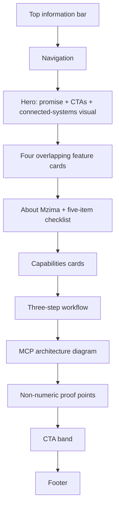
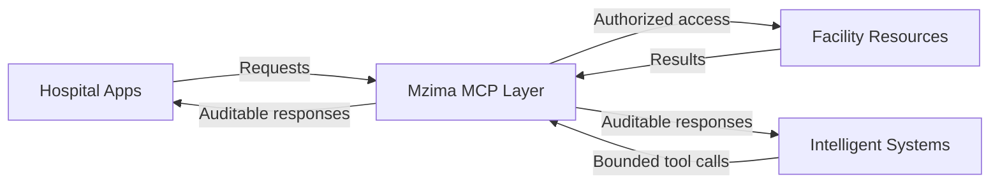

# Mzima landing page specification

This guide turns the supplied brief into a buildable landing-page plan. It covers the complete page from the top bar through the footer at desktop (1440 px) and mobile (390 px). The page introduces Mzima as a proposed healthcare workflow and interoperability platform for Level 6 hospitals in Kenya. It must not imply clinical validation or live-care readiness.

## Page goals

- Explain Mzima in one screenful: connect hospital systems through a controlled MCP layer.
- Let visitors explore the platform, understand its workflow, and open the simulation.
- Establish trust through clear safety boundaries, restrained visuals, and accessible interaction.
- Keep copy concise: headings and labels are brief; descriptions are one line and at most 12 words.

## Page structure

## 1. Top information bar

Show “Level 6 Hospitals, Kenya” on the left with a small scarlet status dot. Give the dot an accessible label such as “Prototype information” so color is not the only signal. Do not call a prototype “live” unless the status is factually live; the visual dot can be present without a misleading live claim. On mobile, keep this single line and avoid wrapping the label into the navigation.

## 2. Navigation

Place the Mzima wordmark on the left, followed by Home, Platform, How It Works, and Capabilities. Use one primary “View simulation” action on the right. Anchor links should move to sections on the same page; the simulation action should go to the actual simulation route when available. At 390 px, show the logo and a 44 px minimum menu button. The opened menu contains the same destinations and closes after navigation or Escape.

## 3. Hero

Use a two-column composition. Left: headline “Connecting Healthcare Systems. Strengthening Human-Centred Care.”, one short supporting sentence, and the buttons “View simulation” and “Explore Platform”. Right: an original abstract network illustration showing hospital systems connecting through a central Mzima MCP hub. Use only line art, nodes, data paths, and facility symbols. No people, faces, avatars, or patient/staff photography.

At 1440 px, center the content in a max-width container with generous vertical space and a 55/45 text-to-visual split. At 390 px, stack the copy above the illustration; keep the headline readable without horizontal overflow. The primary action should be visually dominant and both actions should have clear keyboard focus.

## 4. Four feature cards

Place four cards across the bottom edge of the hero, with a modest overlap that does not cover the hero actions or create a mobile collision. Each card has one line icon, a two-word title, and a description of at most 12 words:

| Title | Description |
| --- | --- |
| Interoperable Systems | Connect existing applications through shared interfaces. |
| Secure Access | Control how services reach facility resources. |
| Workflow Automation | Coordinate operational tasks across systems. |
| Intelligent Systems | Enable bounded, accountable system interactions. |

At 1440 px use four equal columns. At 390 px use a two-column grid or a vertical list; do not use a horizontally scrolling card row as the only way to discover content.

## 5. About Mzima

Use the label “About Mzima”, a concise heading, and a five-item checklist. Suggested heading: “A controlled connection layer for hospital workflows.” Keep each checklist item short:

- Standardized MCP interface
- Controlled resource access
- Audit-ready interactions
- Works with existing systems
- Designed for Level 6 hospitals

Pair this with a technical illustration such as connected facility blocks or a simple data-flow motif. Add a “Learn More” link only when it has a meaningful destination. On narrow screens, put the checklist and illustration in one column and keep each checkmark paired with text.

## 6. Capabilities

Use the label “Capabilities” and a short heading such as “Coordinate essential facility operations.” Show six icon-led cards: Patient Flow, Lab and Diagnostics, Pharmacy, Records, Bed Management, and Alerts. Each card has a recognizable line icon, a short title, and a one-line description of at most 12 words. The Alerts icon may use the scarlet accent; other icons use Egyptian blue or stone blue. Cards should not imply that Mzima performs diagnosis or makes autonomous clinical decisions.

Use three columns at desktop and one or two columns at mobile according to available width. Preserve a comfortable card width and readable text instead of shrinking six cards into one narrow row.

## 7. How it works

Show three numbered steps with simple line illustrations:

1. **01 Connect** — Link existing hospital applications and operational services.
2. **02 Standardize** — Use MCP to provide a consistent, controlled interface.
3. **03 Coordinate** — Support accountable workflows across facility resources.

At desktop, arrange the steps in a row and connect them with a thin directional line. At mobile, stack them and keep the sequence clear. The numbers must remain text, not decoration baked into images.

## 8. MCP architecture diagram

Draw the architecture as a real, labelled diagram rather than a skeleton illustration:

The visual should show Hospital Apps and Intelligent Systems on the left, the Mzima MCP Layer in the center, and Facility Resources on the right. Label arrows with request, authorization, and response concepts. Include a concise note that access is controlled and actions remain subject to configured permissions and human approval where required. Provide an accessible text description for the diagram. If the diagram is interactive, all labels and flow details must still be available without animation.

## 9. Stats band

Use four non-numeric proof points: “Level 6”, “MCP”, “24/7”, and “Open Standards”. Present them as capabilities or design principles, not measured impact claims. Do not invent adoption, performance, or patient-outcome numbers. Use the Egyptian-blue tint or stone-blue tint as a quiet band, with sufficient contrast for all labels.

## 10. CTA band

Use an Egyptian-blue surface with the heading “Ready to connect your hospital?” and one clearly named action. Keep the action’s destination honest: it might open the simulation, provide contact information, or lead to a product discussion, depending on what the project actually supports. Do not imply that a hospital can deploy the prototype directly into live care.

## 11. Footer

Include the Mzima logo, a one-line tagline, a Contact link, key page links, and copyright. Include a short prototype/synthetic-data boundary where appropriate. On mobile, stack footer columns in a clear order; links should remain easy to tap and keyboard focus should be visible.

## Responsive layout checkpoints

| Element | 1440 px desktop | 390 px mobile |
| --- | --- | --- |
| Container | Centered, max-width about 1200 px | 20–24 px side gutters |
| Hero | Two columns, copy left and diagram right | Stacked copy then diagram |
| Feature cards | Four columns, slight hero overlap | Two columns or stacked, no clipping |
| About | Checklist and visual side by side | Single column |
| Capabilities | Three columns by two rows | One or two columns |
| Steps | Three columns with connectors | Vertical sequence |
| Architecture | Three-part left-to-right diagram | Scroll-free stacked flow or clearly labelled vertical flow |
| Footer | Multi-column | Stacked sections |

## Motion and accessibility notes

- Node pulse: animate opacity or a subtle transform, with a slow, low-contrast rhythm. Keep labels static and readable.
- Card hover: small transform and shadow change on devices with fine pointers; never make hover the only feedback.
- Scroll reveal: optional fade-up using opacity and transform, staggered lightly. Content must remain visible when motion is reduced or scripts fail.
- Keep UI transitions under 300 ms; avoid `transition: all` and `ease-in`.
- Provide visible focus rings, semantic heading order, useful illustration alt text, and at least 44 px touch targets.
- Verify text and control contrast against WCAG AA. Do not use scarlet for large fills or rely on color alone.
- Use the project’s motion standards for reduced-motion behavior and hover gating.
