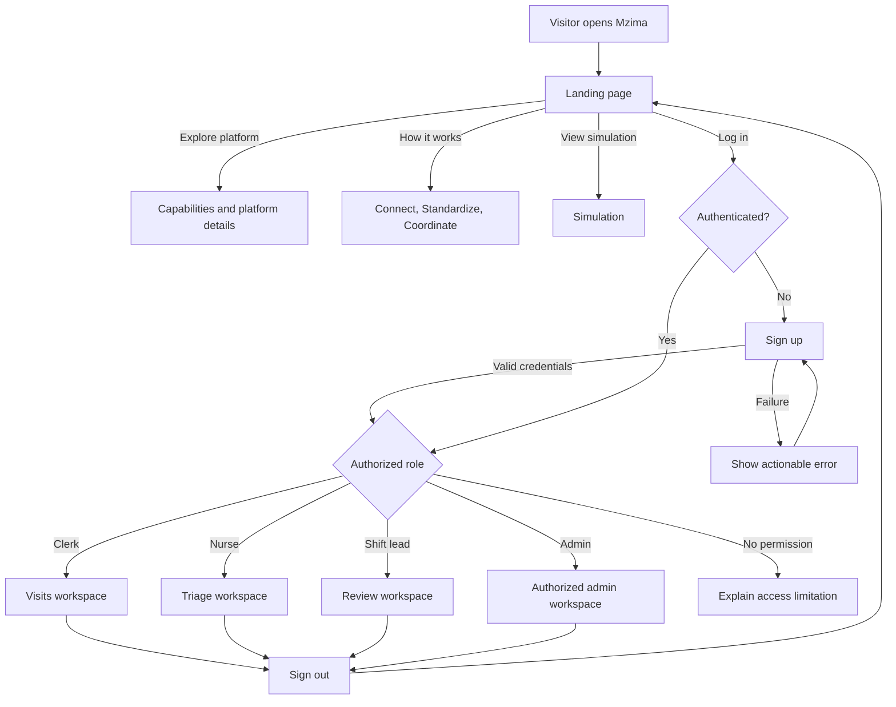
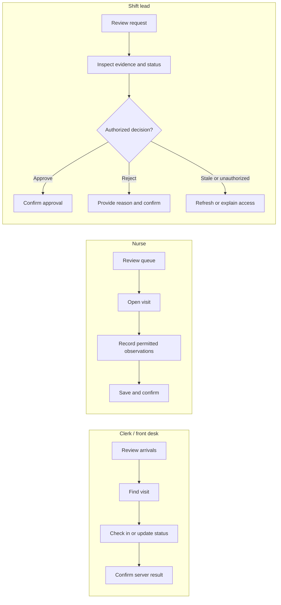
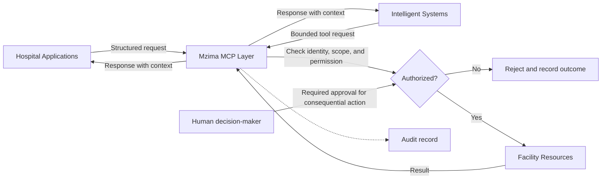

# Mzima usability flows and diagrams

These diagrams describe how a visitor moves from the landing page into the appropriate product area, and how the platform connects systems through MCP. They are intended to guide navigation and page design, not claim that every proposed path is already implemented.

## Visitor-to-workspace usability flow

The login result should be based on the server-confirmed role. If a user follows a protected deep link, return them there only after authorization succeeds. Otherwise send them to their role’s default workspace. Provide visible loading, error, empty, and permission-denied states.

## Operational task flow

## MCP system usability and data flow

The interface should help users understand what is being requested, which resource is involved, whether access was permitted, and whether a human decision is required. The diagram is conceptual; actual permissions and approval rules must match the backend implementation.

## Usability principles for each flow

- Make the next action visible and name it with a verb.
- Keep role, facility, and data freshness visible in authenticated areas.
- Preserve entered data after recoverable errors where safe.
- Confirm consequential actions and show the server-confirmed outcome.
- Explain empty results and provide a practical next step.
- Keep the user’s place and focus stable during background refreshes.
- Make the mobile path complete; do not hide essential actions behind hover or wide tables.
- Keep simulation data clearly labelled as simulated or synthetic.

## Page-level review checklist

1. Can a first-time visitor explain what Mzima does after reading the hero?
2. Can the visitor distinguish the platform from a hospital resource system?
3. Can every role identify its workspace and primary task?
4. Are failure, no-data, stale-data, and denied-access states understandable?
5. Can a keyboard-only user navigate, act, and recover from errors?
6. Does the 390 px layout preserve the same essential actions as desktop?
7. Does every diagram have labels and an equivalent text explanation?
8. Are claims limited to capabilities supported by the current prototype?
